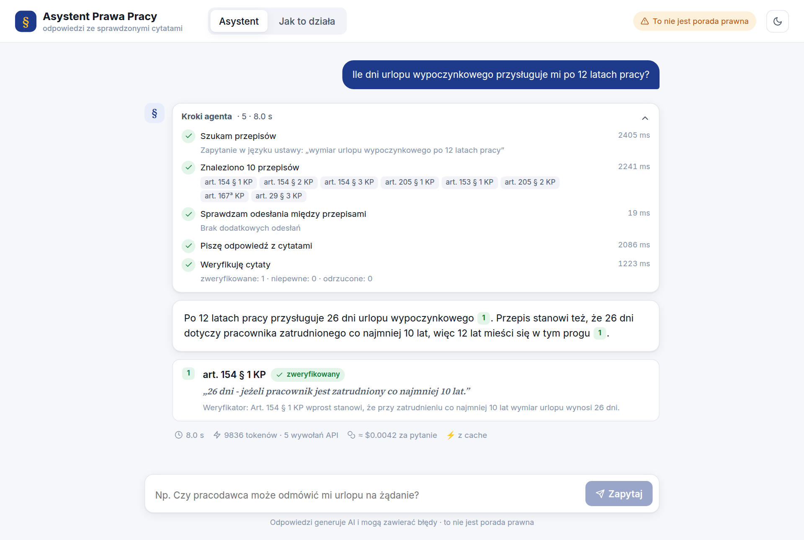
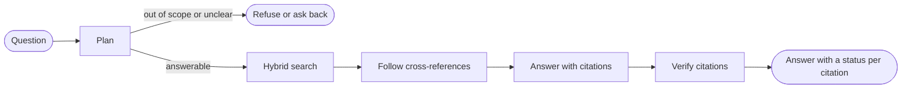

# Asystent Prawa Pracy

**An AI assistant for Polish labour law that proves its answers.** It answers from the full Labour
Code (Kodeks pracy), cites the exact article, § or paragraph, and then automatically checks every
citation: does the provision exist, is the quote really in it, and does it support the claim?



> Portfolio project, not legal advice. The interface and the answers are in Polish.

## Why it exists

A chatbot can state a legal rule with full confidence and cite an article that says something else.
The chat here is only the surface. The work went into retrieval quality, citation verification and
measuring both.

## Results

Evaluated on 33 questions, comparing the full system with a naive RAG baseline (fixed-size chunks,
vector search only):

| Metric | Naive RAG | Asystent Prawa Pracy |
|---|---:|---:|
| Correct answers | 52% | **85%** |
| Citations verified as correct | 12% | **87%** |
| Wrong citations shown to the user | 76% | **0%** |
| Right provision in the top 5 results (recall@5) | 80% | **96%** |
| Out-of-scope questions refused | 6/6 | **6/6** |
| In-scope questions wrongly refused | 1/27 | **0/27** |

A question costs about **$0.004** on the full system.

The questions and expected answers are synthetic: a model generated them and no lawyer reviewed
them. On a set this small one question moves a percentage by about 3 points, so only large
differences are meaningful. "0% wrong" means that the verifier removed every citation it judged
wrong, not that it never misses one. The full report is on the "Jak to działa" page of the app.

## How it works



**Data.** Official consolidated texts come from the Sejm ELI API as HTML. The corpus is the full
Labour Code plus selected topics from the Civil Code and the Consumer Rights Act: 1378 retrieval
units in total, 1178 of them from the Labour Code.

**Structural chunking.** One unit is an article, § or paragraph, stored with its full path, e.g.
`KP, Dział VII, Rozdział I, art. 154 § 1`. The parser matches the API's `/struct` tree 100%.

**Hybrid retrieval.** An LLM first rewrites the question into statutory vocabulary. Lemmatized
full-text search (spaCy, Postgres) and pgvector embeddings are then fused with Reciprocal Rank
Fusion, and a cross-encoder reranks the results.

**LangGraph agent.** It asks for clarification when a question is ambiguous, refuses out-of-scope
questions, and follows references between provisions ("art. 22 § 1" becomes a stored relation).

**Citation verification.** Each citation goes through three checks:

1. The cited provision exists in the database.
2. The quoted fragment is really in it (fuzzy match).
3. A separate LLM judge, which sees only the provision and the claim, decides if one supports the
   other.

The result is *verified*, *uncertain* or *wrong*. Wrong citations are removed from the answer, and
the UI shows the status of the rest. The answer is shown only after this step, so the typing effect
replays checked text instead of streaming raw model output.

**Demo protection.** The public demo has per-IP limits per minute and per day, a global daily
budget, a cap on concurrent agent runs, an answer cache, request size limits, security headers and
a client IP that cannot be spoofed ([D19](docs/DECISIONS.md)).

Every significant choice, with the alternatives considered, is in
[docs/DECISIONS.md](docs/DECISIONS.md).

## Stack

| Layer | Choice |
|---|---|
| Agent | LangGraph |
| LLM | OpenAI `gpt-5.4-mini` (answers), `gpt-5.4-nano` (citation judge) |
| Retrieval | Postgres full-text search, pgvector, Jina v3 embeddings, Jina reranker |
| Lemmatization | spaCy `pl_core_news_sm` |
| Database | PostgreSQL 16 with pgvector |
| API | FastAPI with Server-Sent Events |
| Frontend | React, TypeScript, Vite |
| Tooling | uv, ruff, mypy `--strict`, pytest, GitHub Actions, Docker |

The LLM, embeddings and reranker sit behind provider interfaces chosen in `.env`. A `fake` provider
keeps the tests and CI offline.

## Run locally

Requirements: Docker, [uv](https://docs.astral.sh/uv/), Node 20+, and two API keys:
[OpenAI](https://platform.openai.com/api-keys) (paid) and [Jina](https://jina.ai) (a new key comes
with 10M free tokens).

```bash
cp .env.example .env    # fill in OPENAI_API_KEY and JINA_API_KEY
./scripts/dev.sh        # Postgres + API (:8010) + frontend (:5173)
```

Open http://localhost:5173. The first run downloads the acts from the ELI API and builds the index,
which takes a few minutes.

To make the example questions answer instantly, precompute them while the API is running:

```bash
uv run python -m paragraf.api.warm_cache
```

<details>
<summary>Step by step, without <code>dev.sh</code></summary>

```bash
docker compose up -d db
uv sync
uv run python -m paragraf.ingest            # ELI API -> parse -> Postgres
uv run python -m paragraf.indexing.index    # lemmas + embeddings
uv run uvicorn paragraf.api.main:app --port 8010 --no-proxy-headers
cd frontend && npm install && npm run dev
```

</details>

## Evaluation

```bash
uv run python -m paragraf.evaluation.generate   # synthetic questions, ~70 LLM calls
uv run python -m paragraf.evaluation.run_all    # retrieval + generation, ~200 LLM calls
```

A run costs a few cents and writes `frontend/src/data/eval-report.json`, which is bundled into the
frontend. LLM responses are cached on disk, so a re-run only pays for unfinished calls.

## Deployment

The backend is a single FastAPI process in Docker and the frontend is a static Vite build. The
intended setup is Neon, Render and Vercel, all on free tiers.

**Database (Neon).** Create a Postgres 16 database, point `DATABASE_URL` at it, and load the data
once from your machine (about 2 minutes):

```bash
uv run python -m paragraf.ingest
uv run python -m paragraf.indexing.index
```

**Backend (Render).** Create a web service from the repository root with the Docker runtime. Render
builds the `Dockerfile`, and the app listens on `$PORT`. Set the variables from `.env.example`
without their comments, in particular:

| Variable | Value |
|---|---|
| `DATABASE_URL` | the Neon connection string |
| `OPENAI_API_KEY`, `JINA_API_KEY` | your keys |
| `LLM_PROVIDER` | `openai` |
| `EMBEDDING_PROVIDER`, `RERANKER_PROVIDER` | `jina` |
| `CORS_ORIGINS` | `https://<frontend-domain>` |
| `TRUSTED_PROXY_HOPS` | `1` (one proxy in front of the app) |

`https://<backend-domain>/api/health` should return `{"status": "ok", "chunks": 1378}`. Then
precompute the example questions:

```bash
uv run python -m paragraf.api.warm_cache --url https://<backend-domain>
```

**Frontend (Vercel).** Use the root directory `frontend` and set
`VITE_API_URL=https://<backend-domain>`. `frontend/vercel.json` adds the security headers.

**Sleeping services.** Free tiers put the backend and database to sleep when idle. The frontend
calls `/api/health` on page load so they start waking up right away, and shows a notice if that
takes longer than 1.5 s.

**Spending cap.** Set a monthly budget limit in the OpenAI dashboard. The app's limits bound the
daily cost, but the provider-side cap is the one nothing can route around.

<details>
<summary>Run the backend image locally</summary>

```bash
docker build -t paragraf-api .
docker run --rm --network host -e PORT=8020 -v "$PWD/.env:/app/.env:ro" paragraf-api
```

Mounting `.env` keeps its inline comments working; `--env-file` would pass them as part of the
values.

</details>

## Also included

**MCP server.** It exposes `search_law`, `get_article` and `follow_reference` to MCP clients such as
Claude Desktop. It is a local tool and must not be exposed publicly.

```bash
uv run python -m paragraf.mcp_server.server          # stdio
uv run python -m paragraf.mcp_server.server --http   # streamable HTTP on :8765
```

**Portable bundle.** The database with the indexed corpus, the backend and the frontend, as three
containers packed into one file (about 375 MB). The images contain no secrets. The target machine
needs Docker, internet access and its own `.env`; `bundle/README.txt` has the steps.

```bash
./scripts/bundle.sh     # needs the local database running; writes bundle/
```

## Development

```bash
uv run ruff check . && uv run ruff format --check .
uv run mypy
uv run pytest                 # offline, fake providers
uv run pytest -m integration  # needs the local database
```

```text
backend/paragraf/   eli client, parsing, db, indexing, retrieval, generation, agent, mcp_server, api, providers
backend/tests/      pytest
evals/              dataset, eval results
frontend/           React + TypeScript + Vite
docs/               design decisions, ELI API spec
```
